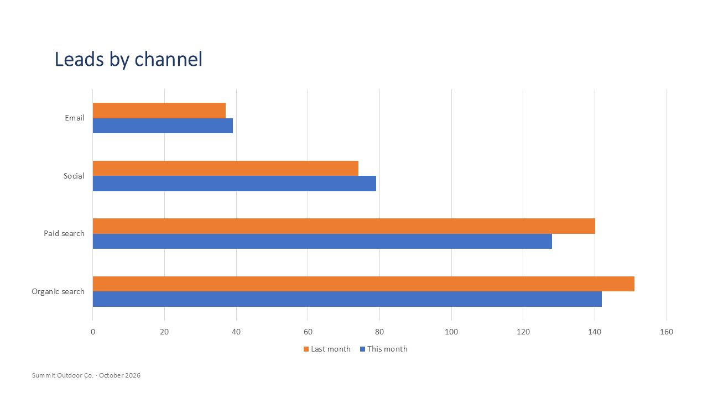

# Client monthly report pack

For agencies and consultants: **one workbook, one deck per client.**

The sample has three clients. Every sheet has a `batch` column with the client's short name.
Rows with an empty `batch` (here: `month` and `agency`) go into every deck.

```sh
deckforge batch template.pptx sample-data.xlsx
# -> template-Harbor Dental.pptx, template-Summit Outdoor.pptx, template-Vela Coffee.pptx
```

In the app, choose the template and workbook and click **Generate decks**; you get one file
per client.

| Slide | What it shows | Filled from |
| --- | --- | --- |
| 1 | Client name, month, agency | `kpis`: `client`, `month`, `agency` |
| 2 | Sessions, leads, conversion rate, ad spend, with trends | `kpis` (+ `previous`) |
| 3 | Leads by channel, this month vs last (bar chart) | `leads_by_channel` sheet |
| 4 | Campaign table: spend, leads, cost per lead | `campaigns` sheet |
| 5 | Notes and next steps | `kpis`: `notes` |

Clients can have different numbers of channels and campaigns: charts and tables fit each one.


