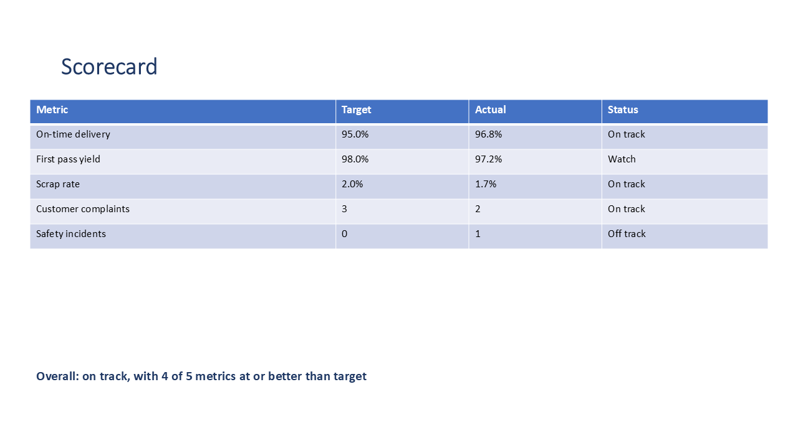

# KPI scorecard pack

A five-slide quality and delivery scorecard.

| Slide | What it shows | Filled from |
| --- | --- | --- |
| 1 | Title and period | `kpis`: `title`, `period` |
| 2 | Scorecard table: target, actual, status | `scorecard` sheet; `kpis`: `overall_status` |
| 3 | Scrap by cause (pie) | `scrap_by_cause` sheet |
| 4 | Volume (columns) vs yield (line, second axis) | `volume_vs_yield` sheet |
| 5 | Safety incidents, **only when there were any** | `kpis`: `incidents`, `incident_notes` |

Slide 5's speaker notes say `#show-if incidents`: set `incidents` to 0 and the slide is left out.

Percent and count rows sit in the same table columns; each cell keeps the number format you
give it in Excel (0.0% for rates, plain for counts).

