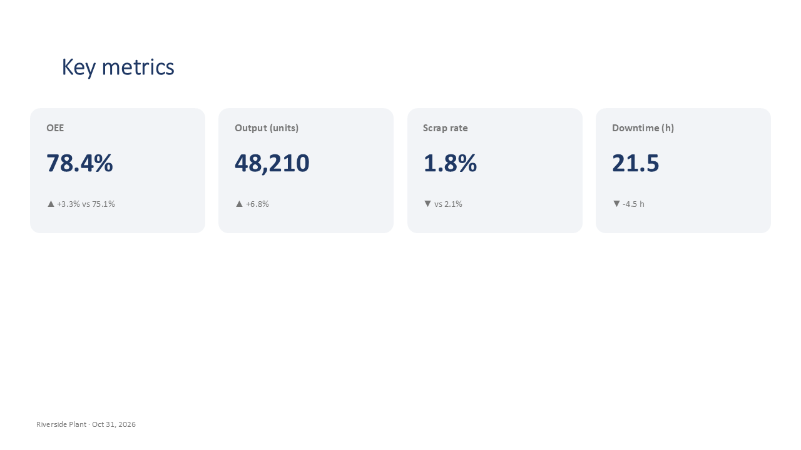

# Ops review pack

A six-slide monthly operations review for one plant or site.

| Slide | What it shows | Filled from |
| --- | --- | --- |
| 1 | Title, site, period | `kpis`: `title`, `site`, `period_start`, `period_end` |
| 2 | Four KPI tiles with trend arrows and change vs last period | `kpis`: `oee`, `output_units`, `scrap_rate`, `downtime_hours` (+ `previous`) |
| 3 | Downtime by cause (table grows/shrinks with your rows) | `downtime` sheet |
| 4 | Planned vs unplanned downtime by line (column chart) | `downtime_by_line` sheet |
| 5 | OEE trend vs target (line chart) | `oee_trend` sheet |
| 6 | Highlights and actions (one line per bullet) | `kpis`: `highlights` |

Every slide's footer shows `{{site}} · {{period_end}}`.

**Monthly routine:** paste last month's export into the sheets (keep the header rows), update
the `kpis` values and `previous` columns, then generate. Save it as a recipe in the app to
make it one click next month.

**More sites?** Add a `batch` column with the site name to each sheet for one deck per site.

